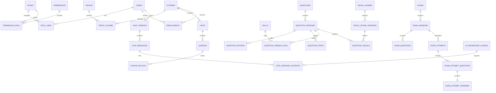

# Roadmap 1 — Thiết kế Database Schema

## 1. Trạng thái tài liệu

- **Task ID:** `DB-001`
- **Module:** Database
- **Trạng thái:** `DB-001 done`; `DB-002 done` — thiết kế đã chốt và Identity/RBAC đã được triển khai, kiểm thử.
- **Ưu tiên:** Critical
- **Nguồn yêu cầu:** `docs/TOAN_LAO_SU_SPEC.md`
- **Database hiện tại:** MySQL, database `toanlaosu`, charset `utf8mb4`, collation `utf8mb4_unicode_ci`, strict mode bật.
- **Laravel:** 12.73.0; PHP 8.2; Pest 3.8.7.

Các migration, model, factory và seeder nghiệp vụ được triển khai theo từng task ở mục 14 bằng `php artisan make:* --no-interaction`; DB-002 đã hoàn tất batch migration 2.

## 2. Mục tiêu

1. Thiết kế schema quan hệ đủ cho toàn bộ domain đã chốt: người dùng, phân quyền, khóa học, lesson block, câu hỏi có version, scene 2D động, thi online, LaTeX và gia sư AI.
2. Bảo đảm dữ liệu bài thi và nội dung đã xuất bản không bị thay đổi ngược bởi thao tác biên tập sau này.
3. Đặt ràng buộc, khóa ngoại và chỉ mục theo các truy vấn thực tế; không thêm index theo cảm tính.
4. Tách dữ liệu cấu hình linh hoạt trong JSON khỏi các trường cần lọc, join, unique hoặc báo cáo.
5. Chuẩn bị migration order, test plan và quy tắc xóa dữ liệu trước khi code.

## 3. Ngoài phạm vi tài liệu này

- Chưa chọn/cài package RBAC, vector database, Filament, Inertia hoặc SDK AI.
- Chưa tạo migration hoặc chạy lệnh thay đổi database.
- Chưa thiết kế data warehouse/BI riêng.
- Chưa tối ưu partitioning; chỉ đánh dấu các bảng có khả năng tăng rất nhanh.
- Không lưu file video/PDF/ZIP trong database; database chỉ lưu metadata và storage key.

## 4. Hiện trạng phải bảo toàn

Ba migration sau đã chạy ở batch 1 và được coi là bất biến:

- `0001_01_01_000000_create_users_table`
- `0001_01_01_000001_create_cache_table`
- `0001_01_01_000002_create_jobs_table`

Các bảng hiện có: `users`, `password_reset_tokens`, `sessions`, `cache`, `cache_locks`, `jobs`, `job_batches`, `failed_jobs`, `migrations`.

Mọi thay đổi với `users` phải nằm trong migration mới; không sửa migration nền tảng đã chạy.

## 5. Quyết định thiết kế đề xuất cần duyệt

### 5.1. Khóa chính và định danh

- Dùng `BIGINT UNSIGNED AUTO_INCREMENT` cho khóa chính để đồng nhất với `users.id` hiện tại.
- Các URL nhạy cảm như bài thi và chat dùng thêm `public_id` dạng ULID, unique; Policy vẫn là lớp bảo vệ chính.
- Không dùng UUID làm khóa chính vì tăng kích thước index và không cần thiết ở giai đoạn hiện tại.

### 5.2. Status và enum

- Cột trạng thái lưu dưới dạng `VARCHAR`, ánh xạ sang PHP backed enum.
- Không dùng MySQL `ENUM` để dễ thay đổi nghiệp vụ và giữ migration portable.
- Giá trị database dùng `snake_case`; Enum PHP dùng key `TitleCase` theo quy tắc dự án.

### 5.3. Versioning và snapshot

- `questions`, `visual_scenes`, `latex_templates` là identity ổn định; nội dung thay đổi nằm trong bảng `*_versions`.
- Version đã `published` hoặc đã được bài thi tham chiếu là bất biến; muốn sửa phải tạo version mới.
- Bài thi dùng `exam_versions` + `exam_attempt_questions` để giữ thứ tự câu/đáp án và điểm của từng thí sinh.
- Không dùng JSON snapshot làm nguồn duy nhất nếu dữ liệu cần join/chấm điểm; JSON chỉ lưu bản sao hỗ trợ audit/khôi phục.

### 5.4. JSON

Chỉ dùng JSON cho:

- Cấu hình scene có schema và `schema_version`.
- Đáp án đầu vào nhiều hình dạng.
- Metadata từ nhà cung cấp video/AI.
- Snapshot/audit không dùng làm khóa quan hệ.

Các trường cần lọc thường xuyên như `status`, `type`, `difficulty`, `course_id`, `user_id`, `starts_at` phải là cột riêng.

### 5.5. Xóa dữ liệu

- Nội dung biên tập dùng soft delete.
- Quan hệ pivot thuần túy được cascade khi parent bị hard delete.
- Dữ liệu lịch sử thi, version đã xuất bản, audit và usage dùng `restrict` hoặc `nullOnDelete`, không cascade âm thầm.
- Tài khoản bị khóa bằng `status`/`locked_at`; không hard delete người dùng trong luồng quản trị thông thường.
- Xóa/anonymize dữ liệu cá nhân là một workflow riêng có audit, không phải `DELETE users` trực tiếp.

### 5.6. Phân quyền

- Đề xuất RBAC nội bộ với `roles`, `permissions`, `role_user`, `permission_role`; chưa thêm package bên ngoài.
- Scope giáo viên vẫn phải được thể hiện bằng `course_teachers` và Laravel Policy; permission không thay thế scope dữ liệu.
- Quy tắc chỉ có một Admin hoạt động được kiểm tra trong application transaction; database không cố tạo partial unique index phụ thuộc engine.

### 5.7. Lesson block

- Không dùng `blockable_type/blockable_id` cho luồng chính vì không có foreign key thực.
- `lesson_blocks` dùng các FK nullable rõ ràng: `video_id`, `material_id`, `question_id`, `visual_scene_id`, cộng `body` cho note.
- Application validation bảo đảm đúng một payload phù hợp với `block_type`.

### 5.8. AI/RAG

- Database lưu tài liệu kiến thức, chunk và citation.
- Giai đoạn đầu dùng tìm kiếm văn bản/full-text trên database; vector search là phần mở rộng sau.
- Khi bổ sung vector search, vector có thể nằm ở dịch vụ ngoài; schema chỉ lưu `external_vector_id` và checksum, không khóa domain vào một nhà cung cấp.
- Nội dung chat và usage tách riêng để có thể áp dụng retention khác nhau.

### 5.9. Các quyết định nghiệp vụ đã chốt

- Giáo viên có thể sở hữu câu hỏi độc lập ngoài course; `questions.owner_id` lưu chủ sở hữu và không bắt buộc câu hỏi phải nằm trong lesson block/course.
- Một học sinh có thể có nhiều enrollment cho cùng course theo các đợt khác nhau; mỗi đợt có `period_number`, thời gian hiệu lực và không được chồng lấn theo policy ứng dụng.
- MVP không hỗ trợ điểm âm; mọi scoring policy của MVP phải có `allow_negative = false`.
- Retention tự động là mặc định. Học sinh không tự xóa dữ liệu trong giao diện; yêu cầu xóa phải liên hệ CSKH để xử lý thủ công và ghi audit.
- Audit log giữ 6 tháng; exam attempt và answer giữ 1 năm. Chat/AI usage áp dụng retention tự động theo thời hạn cấu hình, không có self-service deletion.

## 6. Sơ đồ quan hệ cấp cao



## 7. Quy ước cột chung

- Bảng mutable: `id`, `created_at`, `updated_at`.
- Nội dung soft delete: thêm `deleted_at`.
- Nội dung do người dùng tạo: `created_by`, `updated_by` nullable, FK `users`, `nullOnDelete` để giữ lịch sử.
- Thời điểm nghiệp vụ dùng timestamp UTC; timezone chỉ dùng khi hiển thị.
- Điểm số: `DECIMAL(10,4)`; phần trăm/mastery: `DECIMAL(5,2)`; chi phí AI: `DECIMAL(14,6)`.
- Số thứ tự: unsigned integer và unique trong parent khi thứ tự phải duy nhất.
- Tên index dài phải đặt tên tường minh để không vượt giới hạn MySQL.

## 8. Danh mục bảng chi tiết

### 8.1. Identity, RBAC và access

| Bảng | Cột nghiệp vụ chính | Ràng buộc/index | Xóa |
| --- | --- | --- | --- |
| `users` (alter) | `status VARCHAR(20) default active`, `timezone VARCHAR(64) default Asia/Ho_Chi_Minh`, `preferences JSON nullable`, `locked_at`, `last_login_at`, `last_login_ip VARCHAR(45)` | Giữ `email unique`; index `(status, id)` | Không hard delete trong luồng thường |
| `roles` | `name`, `display_name`, `description`, `is_system` | `name unique` | Restrict khi đang gán |
| `permissions` | `name`, `module`, `description` | `name unique`, index `(module, name)` | Restrict khi đang gán |
| `role_user` | `role_id`, `user_id`, `assigned_by`, `assigned_at` | unique `(role_id, user_id)`, index `(user_id, role_id)` | Cascade pivot; `assigned_by nullOnDelete` |
| `permission_role` | `permission_id`, `role_id` | unique `(permission_id, role_id)` | Cascade pivot |
| `course_teachers` | `course_id`, `user_id`, `scope`, `assigned_by`, `assigned_at`, `revoked_at` | unique `(course_id, user_id)`, index `(user_id, revoked_at)` | Course/user restrict; actors nullOnDelete |
| `enrollments` | `course_id`, `user_id`, `period_number`, `status`, `starts_at`, `ends_at`, `source`, `granted_by`, `revoked_at` | unique `(course_id, user_id, period_number)`, index `(user_id, status, ends_at)` và `(course_id, status, starts_at)` | Course/user restrict; actor nullOnDelete |

`scope` trong `course_teachers` là mức quyền coarse-grained như `owner`, `editor`, `viewer`; hành động cụ thể vẫn do Policy/permission quyết định.

Một user có thể có nhiều enrollment cho cùng course ở các đợt khác nhau. Service phải chặn các khoảng thời gian chồng lấn nếu policy course không cho phép; database giữ `period_number` và unique constraint để định danh từng đợt.

### 8.2. Chương trình và nội dung

| Bảng | Cột nghiệp vụ chính | Ràng buộc/index | Xóa |
| --- | --- | --- | --- |
| `learning_targets` | `code` (`THPT`, `HSA`, `TSA`), `name`, `description`, `sort_order` | `code unique`, `sort_order index` | Restrict |
| `tracks` | `slug`, `title`, `description`, `status`, `published_at`, `sort_order`, actors | `slug unique`, index `(status, published_at, id)` | Soft delete |
| `courses` | `slug`, `title`, `summary`, `status`, `difficulty`, `estimated_minutes`, `published_at`, actors | `slug unique`, index `(status, published_at, id)` và `(difficulty, status)` | Soft delete |
| `track_course` | `track_id`, `course_id`, `sort_order` | unique `(track_id, course_id)`, unique `(track_id, sort_order)` | Cascade pivot |
| `course_learning_target` | `course_id`, `learning_target_id` | unique `(course_id, learning_target_id)` | Cascade pivot |
| `units` | `course_id`, `parent_id nullable`, `slug`, `title`, `description`, `status`, `sort_order`, actors | unique `(course_id, slug)`, unique `(course_id, parent_id, sort_order)`, index `(course_id, status, sort_order)` | Soft delete; parent restrict |
| `lessons` | `unit_id`, `slug`, `title`, `summary`, `status`, `estimated_minutes`, `published_at`, `lock_version`, actors | unique `(unit_id, slug)`, unique `(unit_id, sort_order)`, index `(unit_id, status, sort_order)` | Soft delete |
| `content_revisions` | `content_type`, `content_id`, `version`, `snapshot JSON`, `change_summary`, `created_by`, `created_at` | unique `(content_type, content_id, version)`, index `(content_type, content_id, created_at)` | Append-only; creator nullOnDelete |

`content_revisions` phục vụ course/unit/lesson/lesson block. Question, scene và LaTeX có bảng version riêng vì cần quan hệ và snapshot mạnh hơn.

### 8.3. Video, tài liệu và lesson block

| Bảng | Cột nghiệp vụ chính | Ràng buộc/index | Xóa |
| --- | --- | --- | --- |
| `lesson_videos` | `title`, `provider`, `provider_asset_id`, `disk`, `path`, `status`, `duration_seconds`, `processing_error`, `metadata JSON`, actors | unique nullable `(provider, provider_asset_id)`, index `(status, updated_at)` | Soft delete |
| `lesson_materials` | `title`, `disk`, `path`, `original_name`, `mime_type`, `size_bytes`, `allow_download`, `watermark_enabled`, actors | index `(created_by, created_at)` | Soft delete |
| `lesson_blocks` | `lesson_id`, `block_type`, `sort_order`, `is_blocking`, `body LONGTEXT nullable`, `video_id`, `material_id`, `question_id`, `visual_scene_id`, `settings JSON`, actors | unique `(lesson_id, sort_order)`, index cho từng FK; app kiểm tra đúng payload | Soft delete; asset/content restrict |
| `lesson_block_progress` | `user_id`, `lesson_block_id`, `status`, `attempts_count`, `seconds_spent`, `hints_used`, `started_at`, `completed_at`, `skipped_at`, `last_interaction_at`, `metadata JSON` | unique `(user_id, lesson_block_id)`, index `(user_id, status, last_interaction_at)` | Cascade khi user/progress bị xóa có chủ đích; block restrict |
| `video_progress` | `user_id`, `lesson_video_id`, `last_position_seconds`, `watched_ranges JSON`, `watched_seconds`, `completion_percent`, `last_watched_at`, `completed_at` | unique `(user_id, lesson_video_id)`, index `(user_id, completed_at)` | User cascade có chủ đích; video restrict |
| `material_views` | `user_id nullable`, `lesson_material_id`, `action`, `ip_address`, `user_agent`, `occurred_at` | index `(lesson_material_id, occurred_at)` và `(user_id, occurred_at)` | Material restrict; user nullOnDelete |

### 8.4. Câu hỏi, kỹ năng và tiến độ

| Bảng | Cột nghiệp vụ chính | Ràng buộc/index | Xóa |
| --- | --- | --- | --- |
| `skills` | `parent_id nullable`, `code`, `name`, `description`, `sort_order` | `code unique`, unique `(parent_id, sort_order)` | Restrict khi đang được dùng |
| `questions` | `public_id ULID`, `owner_id nullable`, `question_type`, `status`, `difficulty`, `published_version_id nullable`, `created_by`, `updated_by`, `deleted_at` | `public_id unique`, index `(owner_id, status)`, index `(status, question_type, difficulty, id)` | Soft delete; owner/version null/restrict theo policy |
| `question_versions` | `question_id`, `version`, `stem LONGTEXT`, `solution LONGTEXT`, `answer_config JSON`, `scoring_policy JSON`, `allow_negative`, `content_hash CHAR(64)`, `status`, `published_at`, `created_by` | unique `(question_id, version)`, index `(content_hash)` và `(status, published_at)` | Immutable khi published; restrict |
| `question_options` | `question_version_id`, `option_key`, `content LONGTEXT`, `is_correct`, `score DECIMAL(10,4) nullable`, `feedback TEXT`, `sort_order` | unique `(question_version_id, option_key)`, unique `(question_version_id, sort_order)` | Cascade với draft version; published restrict bằng service |
| `question_steps` | `question_version_id`, `sort_order`, `step_type`, `prompt LONGTEXT`, `answer_config JSON`, `hint LONGTEXT`, `explanation LONGTEXT`, `visual_scene_version_id nullable` | unique `(question_version_id, sort_order)` | Version/scene restrict |
| `question_version_skill` | `question_version_id`, `skill_id`, `weight DECIMAL(5,2)` | unique `(question_version_id, skill_id)` | Cascade pivot |
| `user_attempts` | `user_id`, `question_version_id`, `lesson_block_id nullable`, `attempt_number`, `status`, `answer JSON`, `is_correct nullable`, `score`, `max_score`, `hints_used`, `response_time_ms`, `submitted_at`, `feedback JSON` | index `(user_id, question_version_id, submitted_at)` và `(lesson_block_id, user_id)`; uniqueness theo context do service | Question version/block restrict; user cascade theo workflow |
| `user_mastery` | `user_id`, `skill_id`, `mastery_score`, `confidence_score`, `attempts_count`, `correct_count`, `last_practiced_at`, `next_review_at`, `calculation_version` | unique `(user_id, skill_id)`, index `(user_id, next_review_at)` | User cascade; skill restrict |

`questions.published_version_id` được thêm bằng migration riêng sau khi `question_versions` tồn tại để tránh vòng dependency.

### 8.5. Scene 2D động

| Bảng | Cột nghiệp vụ chính | Ràng buộc/index | Xóa |
| --- | --- | --- | --- |
| `visual_scenes` | `public_id ULID`, `name`, `engine`, `scene_key`, `status`, `published_version_id nullable`, actors, `deleted_at` | `public_id unique`, index `(scene_key, status)` | Soft delete; published version restrict |
| `visual_scene_versions` | `visual_scene_id`, `version`, `schema_version`, `config JSON`, `steps JSON`, `allowed_commands JSON`, `fallback_disk`, `fallback_path`, `status`, `published_at`, `created_by` | unique `(visual_scene_id, version)`, index `(status, published_at)` | Immutable khi published |
| `question_visuals` | `question_version_id`, `visual_scene_version_id`, `purpose`, `sort_order` | unique `(question_version_id, sort_order)`, unique `(question_version_id, visual_scene_version_id, purpose)` | Restrict để giữ version |

`visual_scenes.published_version_id` cũng được thêm sau bảng version. `scene_key` không unique vì nhiều bài có thể dùng cùng một template với config khác nhau.

### 8.6. Thi online

| Bảng | Cột nghiệp vụ chính | Ràng buộc/index | Xóa |
| --- | --- | --- | --- |
| `exams` | `public_id ULID`, `course_id nullable`, `title`, `instructions`, `status`, `starts_at`, `ends_at`, `duration_minutes`, `late_entry_minutes`, `grace_period_seconds`, `max_attempts`, `randomize_questions`, `randomize_options`, `result_release_at`, `answer_release_at`, actors, `deleted_at` | `public_id unique`, index `(status, starts_at, ends_at)` và `(course_id, status)` | Soft delete; course restrict |
| `exam_versions` | `exam_id`, `version`, `settings_snapshot JSON`, `total_points`, `status`, `published_at`, `created_by` | unique `(exam_id, version)` | Immutable khi published |
| `exam_questions` | `exam_version_id`, `question_version_id`, `sort_order`, `points`, `section_key nullable`, `settings JSON` | unique `(exam_version_id, sort_order)`, index `(exam_version_id, section_key)` | Question/version restrict |
| `exam_attempts` | `public_id ULID`, `exam_version_id`, `user_id`, `attempt_number`, `status`, `started_at`, `deadline_at`, `submitted_at`, `graded_at`, `score`, `max_score`, `save_version`, `retention_expires_at`, `metadata JSON` | `public_id unique`, unique `(exam_version_id, user_id, attempt_number)`, index `(status, deadline_at, id)`, index `(retention_expires_at)` | Restrict; tự động xóa sau 1 năm theo retention job, không cascade tùy tiện |
| `exam_attempt_questions` | `exam_attempt_id`, `exam_question_id`, `question_version_id`, `sort_order`, `option_order JSON`, `points`, `snapshot JSON nullable` | unique `(exam_attempt_id, sort_order)`, unique `(exam_attempt_id, exam_question_id)` | Restrict |
| `exam_attempt_answers` | `exam_attempt_question_id`, `answer JSON`, `save_version`, `first_saved_at`, `last_saved_at`, `submitted_at`, `is_correct nullable`, `score nullable`, `grading_details JSON` | unique `exam_attempt_question_id`, index `(last_saved_at)` | Restrict |
| `exam_events` | `exam_attempt_id`, `event_type`, `client_occurred_at nullable`, `occurred_at`, `ip_address`, `user_agent`, `metadata JSON` | index `(exam_attempt_id, occurred_at)` và `(event_type, occurred_at)` | Append-only; attempt restrict |

Autosave dùng optimistic version (`save_version`) và unique row cho mỗi `exam_attempt_question_id`. Submit/chấm điểm phải chạy trong transaction và idempotent lock theo attempt.

### 8.7. LaTeX và export

| Bảng | Cột nghiệp vụ chính | Ràng buộc/index | Xóa |
| --- | --- | --- | --- |
| `latex_templates` | `public_id ULID`, `owner_id nullable`, `name`, `status`, `active_version_id nullable`, actors, `deleted_at` | `public_id unique`, index `(owner_id, status)` | Soft delete |
| `latex_template_versions` | `latex_template_id`, `version`, `preamble`, `header`, `question_format`, `solution_format`, `footer`, `status`, `published_at`, `created_by` | unique `(latex_template_id, version)` | Immutable khi active/used |
| `export_jobs` | `public_id ULID`, `requested_by`, `exam_version_id`, `latex_template_version_id`, `mode`, `status`, `options JSON`, `idempotency_key`, `disk`, `path`, `requested_at`, `completed_at`, `failed_at`, `error_message`, `expires_at` | `public_id unique`, `idempotency_key unique`, index `(requested_by, status, requested_at)` | Actor nullOnDelete; versions restrict |

### 8.8. Gia sư AI và nguồn kiến thức

| Bảng | Cột nghiệp vụ chính | Ràng buộc/index | Xóa |
| --- | --- | --- | --- |
| `ai_knowledge_documents` | `source_type`, `source_id`, `source_version`, `title`, `checksum`, `status`, `provider`, `provider_document_id`, `indexed_at`, `error_message`, `metadata JSON` | unique `(source_type, source_id, source_version)`, index `(status, updated_at)`, index `(checksum)` | Reindex/retire có kiểm soát |
| `ai_knowledge_chunks` | `document_id`, `chunk_index`, `content LONGTEXT`, `token_count`, `content_hash`, `external_vector_id`, `metadata JSON` | unique `(document_id, chunk_index)`, index `(content_hash)`, optional fulltext sau benchmark | Cascade khi document chưa được cite; otherwise restrict/archive |
| `chat_threads` | `public_id ULID`, `user_id`, `course_id nullable`, `lesson_id nullable`, `lesson_block_id nullable`, `question_version_id nullable`, `visual_scene_version_id nullable`, `context_kind`, `mode`, `status`, `title`, `last_message_at`, `retention_expires_at`, `metadata JSON`, `deleted_at` | `public_id unique`, index `(user_id, context_kind, status, last_message_at)`, index `(visual_scene_version_id)`, index `(retention_expires_at)` | Soft delete; source refs restrict |
| `chat_messages` | `chat_thread_id`, `parent_id nullable`, `role`, `status`, `content LONGTEXT`, `model`, `provider_message_id`, `tool_calls JSON`, `prompt_tokens`, `completion_tokens`, `latency_ms`, `error_code`, `created_at` | index `(chat_thread_id, created_at, id)`, optional unique provider message ID | Thread restrict; append-only |
| `chat_message_sources` | `chat_message_id`, `ai_knowledge_chunk_id`, `citation_order`, `label`, `quoted_excerpt TEXT nullable`, `metadata JSON` | unique `(chat_message_id, citation_order)`, unique `(chat_message_id, ai_knowledge_chunk_id)` | Restrict citation integrity |
| `ai_usage_logs` | `user_id nullable`, `chat_message_id nullable`, `provider`, `model`, `operation`, `status`, `prompt_tokens`, `completion_tokens`, `cost`, `latency_ms`, `error_code`, `occurred_at`, `retention_expires_at` | index `(user_id, occurred_at)`, `(provider, model, occurred_at)`, `(status, occurred_at)`, `(retention_expires_at)` | User/message nullOnDelete; automatic retention |
| `ai_feedback` | `chat_message_id`, `user_id`, `rating`, `reason`, `comment`, `reviewed_by`, `reviewed_at` | unique `(chat_message_id, user_id)`, index `(rating, reviewed_at)` | User/reviewer nullOnDelete; message restrict |

Không lưu API key trong các bảng này. Secret phải nằm trong environment/secret store và được truy cập qua config.

`chat_threads` có một context chính thuộc `course`, `lesson`, `lesson_block`, `question_version` hoặc `visual_scene_version`; `context_kind` phải khớp với foreign key tương ứng và service phải kiểm tra các reference cùng scope course/lesson. Question và scene luôn pin vào version. Video/material được truy xuất qua `lesson_block` và knowledge metadata, không thêm foreign key trực tiếp ở MVP. `mode=exam` bị chặn ở server; teacher authoring dùng mode riêng, không dùng chung thread Student Tutor.

### 8.9. Vận hành và audit

| Bảng | Cột nghiệp vụ chính | Ràng buộc/index | Xóa |
| --- | --- | --- | --- |
| `webhook_events` | `provider`, `provider_event_id`, `event_type`, `status`, `payload JSON`, `received_at`, `processed_at`, `failed_at`, `error_message` | unique `(provider, provider_event_id)`, index `(status, received_at)` | Retention theo thời hạn; không sửa payload |
| `audit_logs` | `actor_id nullable`, `event`, `auditable_type`, `auditable_id`, `old_values JSON`, `new_values JSON`, `ip_address`, `user_agent`, `occurred_at`, `retention_expires_at` | index `(auditable_type, auditable_id, occurred_at)`, `(actor_id, occurred_at)`, `(event, occurred_at)`, `(retention_expires_at)` | Append-only; automatic deletion after 6 months; actor nullOnDelete |
| `system_settings` | `key`, `value JSON`, `updated_by`, timestamps | `key unique` | Restrict; không chứa secret |

`material_views`, `exam_events`, `chat_messages`, `ai_usage_logs` và `audit_logs` là các bảng tăng nhanh; phải dùng cursor/chunk cho export và job retention. `audit_logs` giữ 6 tháng; `exam_attempts`/`exam_attempt_answers` giữ 1 năm; chat và AI usage xóa tự động theo `retention_expires_at`. Yêu cầu xóa sớm phải đi qua CSKH và được ghi audit.

## 9. Ma trận hành vi xóa

| Loại dữ liệu | Quy tắc |
| --- | --- |
| Pivot (`role_user`, `track_course`, tag kỹ năng) | Cascade theo parent |
| Nội dung draft chưa được tham chiếu | Có thể hard delete qua service sau kiểm tra |
| Nội dung published | Soft delete identity; version giữ nguyên |
| Question/scene/template version đang được tham chiếu | Restrict |
| Exam version, attempt, answer, event | Restrict; không cascade |
| Creator/reviewer/actor | `nullOnDelete` để giữ lịch sử |
| Progress cá nhân | Xóa/anonymize theo workflow quyền riêng tư |
| Audit/webhook/usage | Retention theo policy; không sửa ngược |

## 10. Ma trận truy vấn và chỉ mục nóng

| Truy vấn | Index dự kiến |
| --- | --- |
| Danh sách khóa học đã xuất bản | `courses(status, published_at, id)` |
| Bài học theo unit và thứ tự | `lessons(unit_id, status, sort_order)` |
| Khối bài học | unique `lesson_blocks(lesson_id, sort_order)` |
| Kiểm tra enrollment | unique `(course_id, user_id)` + `(user_id, status, ends_at)` |
| Câu hỏi theo loại/độ khó | `questions(status, question_type, difficulty, id)` |
| Ôn tập đến hạn | `user_mastery(user_id, next_review_at)` |
| Ca thi sắp mở/đang mở | `exams(status, starts_at, ends_at)` |
| Worker tự đóng bài hết giờ | `exam_attempts(status, deadline_at, id)` |
| Autosave câu trả lời | unique `exam_attempt_answers(exam_attempt_question_id)` |
| Lịch sử chat | `chat_messages(chat_thread_id, created_at, id)` |
| Theo dõi chi phí AI | `ai_usage_logs(provider, model, occurred_at)` |
| Chống webhook lặp | unique `webhook_events(provider, provider_event_id)` |

Khi triển khai, phải kiểm tra index thực tế bằng `SHOW INDEX`/Boost và dùng `EXPLAIN` với dữ liệu đại diện. Không tạo index đơn trùng với prefix của composite index nếu không có query riêng chứng minh nhu cầu.

## 11. Thứ tự migration đề xuất

### Wave A — Identity và access

1. Alter `users` thêm trạng thái/account metadata.
2. Tạo roles, permissions và pivots.
3. Tạo learning targets, tracks, courses và pivots.
4. Tạo units, lessons, course teachers, enrollments.

### Wave B — Nội dung học tập

1. Tạo videos, materials.
2. Tạo skills, questions, question versions/options.
3. Tạo visual scenes và versions.
4. Tạo question steps, question skill, question visuals.
5. Thêm `published_version_id` vào question/scene.
6. Tạo lesson blocks, content revisions và progress.

### Wave C — Thi cử

1. Tạo exams, exam versions/questions.
2. Tạo attempts, frozen attempt questions, answers và events.
3. Thêm index worker/autosave sau khi xác nhận query.

### Wave D — LaTeX và AI

1. Tạo LaTeX templates/versions, sau đó thêm `active_version_id`.
2. Tạo export jobs và webhook events.
3. Tạo knowledge documents/chunks.
4. Tạo chat threads/messages/sources, usage và feedback.
5. Tạo audit logs/system settings.

Mỗi migration phải tập trung, có `down()` trung thực và không chứa backfill lớn. Job/event phát sinh trong transaction chỉ được dispatch sau commit.

## 12. Kế hoạch model, factory và seeder sau khi duyệt

- Tạo model bằng Artisan, có relationship return type rõ ràng và casts trong `casts()`.
- Tạo factory cho mọi model dùng trong feature test; dùng state có nghĩa như `published()`, `draft()`, `inProgress()`.
- Seeder chỉ tạo dữ liệu chuẩn nhỏ: roles, permissions, learning targets và một Admin ban đầu theo cơ chế an toàn; không hard-code mật khẩu thật.
- Dùng PHP enum cho status/type và kiểm tra mọi case qua dataset Pest.
- Bật ngăn lazy loading ở môi trường development để bắt N+1 sớm.

## 13. Kế hoạch kiểm thử

### 13.1. Migration và schema

- Chạy `php artisan migrate:status` trước và sau từng wave.
- Chạy migration trên database test rỗng; chỉ dùng `migrate:fresh` với database test disposable đã xác nhận, tuyệt đối không dùng database `toanlaosu` hiện tại.
- Kiểm tra rollback từng wave trong test/CI và migrate lại từ đầu.
- Dùng Boost `database-schema` để xác nhận cột, nullable, default, index và foreign key thực tế.

### 13.2. Feature test giá trị cao

- Một email không thể tạo hai user.
- Không thể gán trùng role, cùng `enrollment period`, skill hoặc question order; nhiều enrollment khác period được phép nếu không chồng lấn theo policy.
- Giáo viên sở hữu được question độc lập ngoài course và giáo viên ngoài owner/course scope bị từ chối truy cập.
- MVP từ chối scoring policy có `allow_negative = true`.
- Giáo viên ngoài `course_teachers` không thể truy cập nội dung của course.
- Published question version không bị thay đổi khi tạo version mới.
- Xóa mềm question/lesson không làm mất dữ liệu attempt lịch sử.
- Một attempt chỉ có một answer row cho mỗi frozen question; hai autosave dùng optimistic version không ghi đè im lặng.
- Hai submit đồng thời chỉ chấm một lần.
- Sửa question sau khi exam bắt đầu không đổi `exam_attempt_questions`.
- Citation chat không thể trỏ tới chunk không tồn tại.
- Webhook cùng `provider_event_id` chỉ được ghi/ xử lý một lần.
- Xóa/khóa user không cascade làm mất exam history, audit hoặc usage.

### 13.3. Hiệu năng

- Seed dữ liệu đại diện trong môi trường test/performance riêng.
- `EXPLAIN` các truy vấn trong mục 10; lưu kết quả khi bắt đầu tối ưu thực tế.
- Kiểm tra N+1 cho trang lesson, câu hỏi, exam review và dashboard giáo viên.
- Load test autosave chỉ thực hiện khi đã chốt số thí sinh đồng thời và chu kỳ lưu.

### 13.4. Lệnh xác minh dự kiến

```powershell
php artisan migrate:status
php artisan test --compact tests/Feature/Database
vendor/bin/pint --dirty --format agent
node --check docs/assets/pm-board/pm-board.js
```

Số test/assertion chỉ cập nhật dashboard sau khi các lệnh thật sự được chạy.

## 14. Task breakdown và dependency

| ID | Task | Dependency | Trạng thái |
| --- | --- | --- | --- |
| `DB-001` | Duyệt quyết định schema, bảng, deletion policy và migration order | Không | `done` |
| `DB-002` | Identity, RBAC, account status và seed dữ liệu chuẩn | `DB-001` | `done` |
| `DB-003` | Tracks, courses, units, lessons, teacher scope và enrollment | `DB-002` | `done` |
| `DB-004` | Media, lesson blocks, question bank, skills và scene 2D versioning | `DB-003` | `done` |
| `DB-005` | Learning progress, attempts và mastery | `DB-004` | `done` |
| `DB-006` | Exam versions, frozen attempts, autosave answers và events | `DB-004` | `done` |
| `DB-007` | LaTeX templates, export jobs, webhook idempotency | `DB-006` | `done` |
| `DB-008` | AI knowledge, chat, citations, usage và feedback | `DB-004` | `done` |
| `DB-009` | Audit, factories, seeders và database feature tests | `DB-002..DB-008` | `backlog` |
| `DB-010` | Index review, EXPLAIN, migration rehearsal và schema sign-off | `DB-009` | `done` |

## 15. Checklist hoàn tất `DB-001`

- [x] Duyệt MySQL + `BIGINT` làm chuẩn.
- [x] Duyệt RBAC nội bộ, chưa thêm package.
- [x] Duyệt status bằng `VARCHAR` + PHP enum.
- [x] Duyệt versioning bất biến cho question/scene/exam/LaTeX.
- [x] Duyệt lesson block dùng FK nullable thay vì morph.
- [x] Duyệt deletion matrix và việc không hard delete user trong luồng thường.
- [x] Duyệt schema thi có `exam_attempt_questions` riêng.
- [x] Duyệt schema AI có knowledge document/chunk và tìm kiếm văn bản trước vector.
- [x] Duyệt migration waves A–D.
- [x] Chốt ownership question, enrollment nhiều kỳ, điểm âm MVP, retention và thời hạn lưu.

## 16. Checklist hoàn tất `DB-002`

- [x] Migration identity fields cho `users`.
- [x] Bảng `roles`, `permissions` và pivot RBAC với khóa ngoại/index phù hợp.
- [x] `UserStatus` enum, casts, `isActive()` và quan hệ Eloquent.
- [x] Factories và seeders roles/permissions idempotent.
- [x] Feature tests cho account status, quyền, quan hệ và unique assignment.
- [x] Migration batch 2 và schema thực tế đã được xác nhận.
- [x] Full test suite đạt 6 tests/13 assertions.

## 17. Checklist hoàn tất `DB-003`

- [x] Migration cho learning targets, tracks, courses và các pivot curriculum.
- [x] Migration cho teacher scope, enrollment nhiều kỳ, units, lessons và content revisions.
- [x] Model/factory/quan hệ Eloquent cho curriculum và access.
- [x] Soft delete cho track/course/unit/lesson; actor FK dùng `nullOnDelete`.
- [x] Unique/index/FK cho thứ tự nội dung, teacher scope và enrollment period.
- [x] Feature tests cho curriculum ordering, teacher scope và enrollment nhiều kỳ.
- [x] Migration batch 3 và schema thực tế đã được xác nhận.
- [x] Full test suite đạt 10 tests/25 assertions.

## 18. Checklist hoàn tất `DB-004`

- [x] Media video/tài liệu với metadata, trạng thái xử lý và soft delete.
- [x] Lesson blocks có thứ tự, blocking, payload và FK asset/content.
- [x] Skills dạng cây và question ownership độc lập ngoài course.
- [x] Question versions, options, steps, scoring config và `allow_negative = false` mặc định.
- [x] Scene 2D versioning với config/steps/allow-list command và fallback.
- [x] Published version FK tách riêng để xử lý vòng phụ thuộc question/scene.
- [x] Feature tests cho media block, question ownership/version và scene config động.
- [x] Migration batch 4-7 và schema thực tế đã được xác nhận.
- [x] Full test suite đạt 13 tests/38 assertions.

## 19. Checklist hoàn tất `DB-005`

- [x] `lesson_block_progress` unique theo user/block và index trạng thái tương tác.
- [x] `video_progress` unique theo user/video, watched ranges và completion percent.
- [x] `material_views` append-only, hỗ trợ user ẩn danh và index thời gian.
- [x] `user_attempts` lưu đáp án, scoring, hint, timing và feedback.
- [x] `user_mastery` unique theo user/skill với lịch ôn tập và calculation version.
- [x] Quan hệ Eloquent, casts và factories cho toàn bộ progress domain.
- [x] Feature tests cho uniqueness, progress state, anonymous view, attempt và mastery.
- [x] Migration batch 8 và schema thực tế đã được xác nhận.
- [x] Full test suite đạt 16 tests/50 assertions.

## 20. Checklist hoàn tất `DB-006`

- [x] `exams` và `exam_versions` với version bất biến, lịch thi và release policy.
- [x] `exam_questions` tham chiếu question version và giữ thứ tự/điểm cấu hình.
- [x] `exam_attempts` có public ULID, attempt number unique, deadline và retention 1 năm.
- [x] `exam_attempt_questions` lưu frozen snapshot và option order riêng từng thí sinh.
- [x] `exam_attempt_answers` unique một answer hiện hành, save version cho optimistic autosave.
- [x] `exam_events` append-only với client/server timestamps và metadata.
- [x] Forward migration xử lý FK vòng và tương thích MySQL strict mode.
- [x] Feature tests cho snapshot, autosave uniqueness, events và attempt uniqueness.
- [x] Migration batch 9-10 và schema thực tế đã được xác nhận.
- [x] Full test suite đạt 19 tests/59 assertions.

## 21. Checklist hoàn tất `DB-007`

- [x] `latex_templates` identity ổn định với owner, status và active version.
- [x] `latex_template_versions` lưu preamble/format bất biến theo version.
- [x] `export_jobs` liên kết exact exam/template version, trạng thái và file output.
- [x] `idempotency_key` unique cho export job.
- [x] `webhook_events` lưu payload append-only và unique theo provider/event ID.
- [x] Forward migration xử lý FK vòng giữa template và active version.
- [x] Feature tests cho version linking, export idempotency và webhook deduplication.
- [x] Migration batch 11 và schema thực tế đã được xác nhận.
- [x] Full test suite đạt 22 tests/65 assertions.

## 22. Checklist hoàn tất `DB-008`

- [x] Knowledge documents/chunks với checksum, source version và external vector ID tùy chọn.
- [x] Threaded chat với user/course/lesson/question context và retention expiry.
- [x] Chat messages append-only, parent/child thread và provider message ID tùy chọn.
- [x] Citation sources unique theo message/order và message/chunk.
- [x] AI usage logs lưu token, cost, latency, status và retention expiry.
- [x] AI feedback rating/reason/reviewer với unique user/message.
- [x] Forward migration xử lý FK vòng knowledge/chat.
- [x] Feature tests cho citations, threaded chat, usage và feedback deduplication.
- [x] Migration batch 12 và schema thực tế đã được xác nhận.
- [x] Full test suite đạt 25 tests/74 assertions.

## 23. Checklist hoàn tất `DB-009`

- [x] `audit_logs` append-only với actor nullable, auditable reference và retention 6 tháng.
- [x] `system_settings` lưu cấu hình JSON, unique key và updater nullable.
- [x] Audit/system settings model, casts, relationships và factories đã được tạo.
- [x] Seeder system settings idempotent cho retention audit 6 tháng, exam 1 năm và vector search tắt.
- [x] Feature tests bao phủ actor nullOnDelete, retention, seed idempotency và duplicate key.
- [x] Migration batch 13 và schema thực tế đã được xác nhận.
- [x] Full test suite đạt 28 tests/82 assertions.

## 24. Quyết định đã chốt từ người dùng

| Chủ đề | Quyết định |
| --- | --- |
| Question ownership | Giáo viên có thể sở hữu question độc lập ngoài course; lưu `questions.owner_id`. |
| Enrollment | Một user có thể có nhiều đợt học cùng course; định danh bằng `period_number`, chặn overlap ở service. |
| Negative score | Không hỗ trợ trong MVP; `allow_negative = false`. |
| Xóa dữ liệu người dùng | Retention tự động; muốn xóa sớm phải liên hệ CSKH để xử lý thủ công và ghi audit. |
| AI search | Triển khai tìm kiếm văn bản/full-text trước; vector search để giai đoạn sau. |
| Audit retention | Tự động giữ 6 tháng. |
| Exam retention | `exam_attempts`, `exam_attempt_answers` và event liên quan giữ 1 năm. |
| AI context binding | Chatbot gắn với course/lesson/lesson block/question version/visual scene version; video/material đi qua lesson block; exam bị vô hiệu hóa; teacher authoring dùng mode riêng. |
| AI voice | MVP dùng text; mở rộng voice input qua Speech-to-Text rồi voice output qua Text-to-Speech. Transcript lưu ở `chat_messages.content`, audio tạm thời ở object storage theo retention; exam chặn cả voice input/output. |

## 26. Checklist hoàn tất `DB-010`

- [x] Rà soát các composite index theo query pattern thực tế, không thêm index speculative.
- [x] `EXPLAIN` 6 query đại diện cho enrollment, lesson blocks, exam answers, chat messages, audit retention và knowledge chunks.
- [x] Query plan xác nhận dùng index tương ứng; các query trên bảng trống trả về `Impossible WHERE` là kết quả dữ liệu, không phải thiếu index.
- [x] Migration rehearsal toàn bộ schema trên SQLite in-memory đã chạy thành công từ đầu đến batch 13.
- [x] Full regression đạt 28 tests/82 assertions.
- [x] Dashboard, roadmap và migration status đã đồng bộ; database schema sign-off hoàn tất.

## 27. Điều kiện hoàn thành roadmap database

- Toàn bộ quyết định mục 5 và bảng quyết định mục 24 đã được duyệt.
- Các task `DB-002` đến `DB-010` được triển khai và test theo dependency.
- Schema thực tế khớp roadmap và `database-schema` không phát hiện thiếu FK/index bắt buộc.
- Test mục tiêu và regression đều đạt; kết quả thật được ghi vào dashboard.
- `pm-board.js`, roadmap và migration status đồng bộ.

