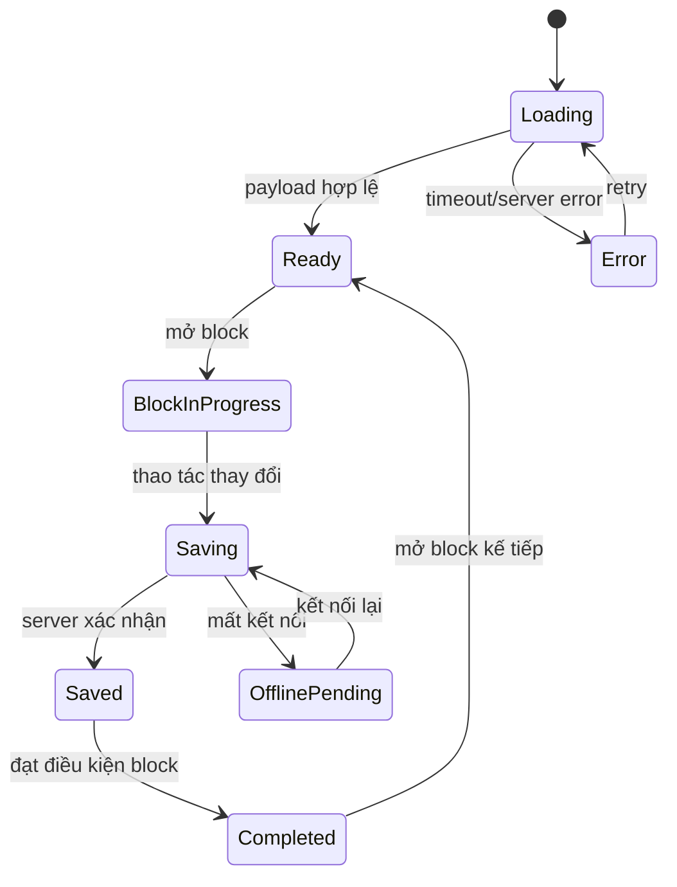
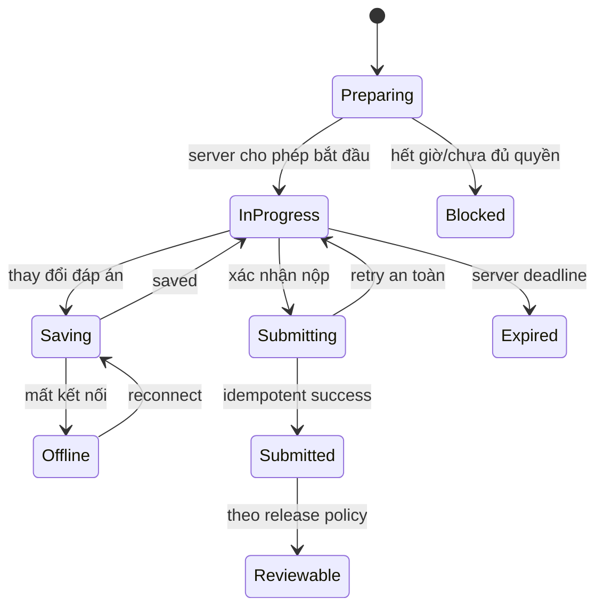
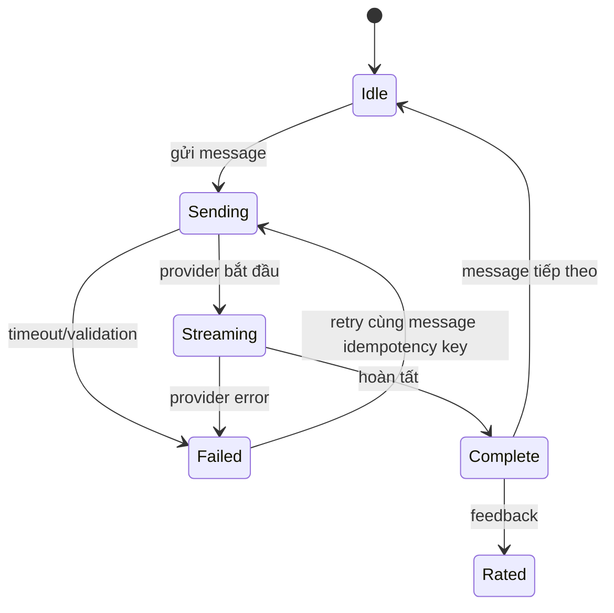
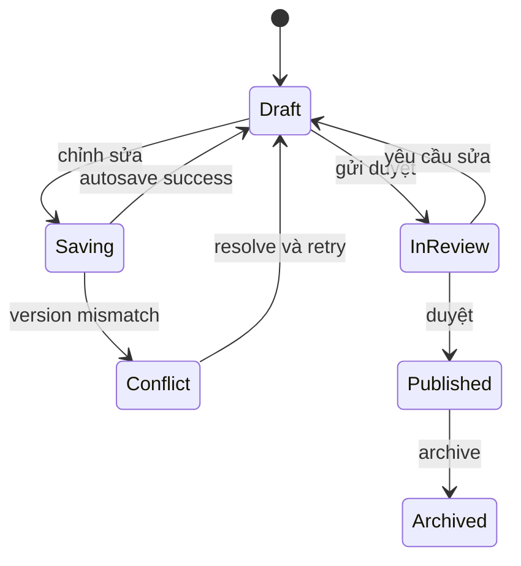

# Roadmap giao diện Toán Lão Sư

## 1. Mục tiêu

Xây dựng giao diện mobile-first cho ba vai trò Học sinh, Giáo viên và Admin, trong đó trải nghiệm học tập phải khác biệt nhờ lesson dạng chuỗi khối, mô hình 2D động, bài thi chịu lỗi và gia sư AI theo ngữ cảnh.

Roadmap này chỉ chốt phạm vi, thứ tự, tiêu chí nghiệm thu và kế hoạch kiểm thử. Không cài thêm dependency frontend trước khi `UI-001` được duyệt.

## 2. Hiện trạng repository

- Laravel `12.73.0`, PHP 8.2, Vite `7`, Tailwind CSS `4`.
- Frontend hiện chỉ có `welcome.blade.php`, `resources/css/app.css` và JavaScript bootstrap mặc định.
- Chưa có authentication UI, Inertia, Vue, TypeScript, thư viện hiển thị công thức, scene 2D hoặc E2E/browser test.
- Database roadmap `DB-001..DB-010` đã hoàn tất; giao diện có thể bám vào schema và policy nghiệp vụ đã chốt.
- Việc triển khai UI cần đi cùng route, controller/action, policy và API nhỏ theo từng vertical slice; không dựng màn hình giả tách rời dữ liệu thật quá lâu.

## 3. Nguyên tắc trải nghiệm

1. **Học tập là luồng chính:** dashboard chỉ dẫn người học quay lại đúng bài/khối đang dở.
2. **Động nhưng có kiểm soát:** animation hỗ trợ hiểu toán, luôn có play/pause/seek/reset và fallback tĩnh.
3. **Trạng thái rõ ràng:** mọi thao tác dài phải có `loading`, `success`, `error`, `retry`; autosave có `saving`, `saved`, `offline`, `conflict`.
4. **Mobile-first:** chức năng cốt lõi dùng được ở 360px; desktop mở rộng không gian thay vì đổi logic.
5. **Không phụ thuộc màu:** trạng thái đúng/sai, khóa/mở, online/offline phải có chữ, biểu tượng và thông báo cho screen reader.
6. **Bàn phím và giảm chuyển động:** focus rõ, thứ tự tab hợp lý, `prefers-reduced-motion` và nút tắt animation.
7. **Toán học dễ đọc:** công thức không làm tràn màn hình; biểu thức dài có scroll ngang hoặc xuống dòng có chủ đích.
8. **Quyền ở cả UI và server:** ẩn hành động không đủ; mọi route/action vẫn phải được policy bảo vệ.

## 4. Kiến trúc frontend đề xuất

### 4.1. Stack cần duyệt ở `UI-001`

- **Ứng dụng:** Inertia + Vue 3 + TypeScript.
- **Styling:** Tailwind CSS 4, design tokens trong `resources/css/app.css`.
- **Toán:** ưu tiên KaTeX cho render nhanh; chỉ dùng MathJax nếu prototype chứng minh KaTeX thiếu tính năng bắt buộc.
- **Scene 2D:** SVG/Vue cho hình học tương tác; Canvas cho nhiều phần tử; chart/graph library chỉ lazy-load theo `scene_key`.
- **State:** page props + composable cục bộ; chưa thêm Pinia nếu chưa có state dùng xuyên nhiều page.
- **Test:** Pest cho route/policy/page props; Vitest cho logic component/composable; Playwright cho luồng trình duyệt quan trọng. Mọi package mới cần được duyệt trước khi cài.

Không khuyến nghị tách Admin sang Filament ngay trong MVP vì sẽ tạo hai hệ UI và hai cách kiểm thử. Có thể đánh giá lại sau prototype `UI-011..UI-013`.

### 4.2. Cấu trúc dự kiến

```text
resources/
├── css/app.css
├── js/
│   ├── app.ts
│   ├── Components/
│   │   ├── Ui/
│   │   ├── Math/
│   │   ├── Learning/
│   │   ├── Exam/
│   │   ├── Scene/
│   │   └── Chat/
│   ├── Composables/
│   ├── Layouts/
│   ├── Pages/
│   │   ├── Auth/
│   │   ├── Student/
│   │   ├── Teacher/
│   │   └── Admin/
│   ├── Scenes/
│   ├── Types/
│   └── Utilities/
└── views/app.blade.php
```

### 4.3. Ranh giới dữ liệu

- Inertia page props chỉ chứa dữ liệu cần cho lần render hiện tại, không gửi toàn bộ model/JSON lớn.
- Eloquent Resource/ViewModel chuẩn hóa payload và tránh lộ cột nội bộ.
- Autosave bài thi, chat streaming, upload và scene command dùng endpoint chuyên biệt có idempotency/rate limit phù hợp.
- URL tài liệu/video được cấp ngắn hạn sau khi server kiểm tra enrollment.
- Scene chỉ nhận cấu hình đã validate và command allow-list; không render HTML/JavaScript do người dùng hoặc AI sinh.

## 5. Kiến trúc thông tin

### 5.1. Public và xác thực

- Trang giới thiệu ngắn gọn, nhấn mạnh học bằng mô hình 2D động.
- Đăng nhập, quên/đặt lại mật khẩu, xác minh email và trạng thái tài khoản bị khóa.
- Sau đăng nhập điều hướng theo vai trò; người có nhiều vai trò có bộ chuyển workspace rõ ràng.

### 5.2. Học sinh

- Tổng quan: tiếp tục học, lịch thi, tiến độ, nội dung cần ôn.
- Lộ trình → khóa học → chương → bài học.
- Lesson player dạng một dòng chảy block; mục lục thu gọn chỉ để định hướng.
- Bài luyện/câu hỏi, scene 2D, gia sư AI, danh sách ôn tập.
- Thi online, kết quả và review theo chính sách công bố.
- Hồ sơ, thiết bị và cài đặt giảm chuyển động.

### 5.3. Giáo viên

- Dashboard phạm vi được giao và việc cần xử lý.
- Quản lý khóa học, lesson blocks, video/tài liệu.
- Ngân hàng câu hỏi, version, kỹ năng, Live Preview công thức/scene.
- Đề thi, ca thi, export LaTeX, tiến độ học sinh và feedback AI.

### 5.4. Admin

- Người dùng, vai trò, teacher scope và enrollment.
- Workflow duyệt nội dung, audit log và system settings.
- Theo dõi ca thi, Queue/webhook/video lỗi và chi phí AI.
- Quản lý scene template, LaTeX template và chính sách retention.

### 5.5. Route map dự kiến

| Khu vực | Route pattern | Layout | Quyền/điều kiện |
| --- | --- | --- | --- |
| Public | `/`, `/about` | PublicLayout | Khách hoặc người dùng đã đăng nhập |
| Auth | `/login`, `/forgot-password`, `/verify-email` | AuthLayout | Guest hoặc trạng thái tài khoản phù hợp |
| Student | `/dashboard`, `/courses/{course}`, `/lessons/{lesson}` | Student/LearningLayout | Enrollment còn hiệu lực |
| Student | `/practice`, `/review`, `/exams`, `/exams/{exam}/attempts/{attempt}` | Student/ExamLayout | Quyền học/ca thi và release policy |
| Student | `/lessons/{lesson}/chat` | LearningLayout + Chat drawer | Enrollment, không trong exam |
| Teacher | `/teacher`, `/teacher/courses`, `/teacher/lessons`, `/teacher/questions` | WorkspaceLayout | Teacher scope/policy |
| Teacher | `/teacher/scenes`, `/teacher/exams`, `/teacher/exports`, `/teacher/reports` | WorkspaceLayout | Teacher scope và permission module |
| Admin | `/admin`, `/admin/users`, `/admin/content`, `/admin/audit`, `/admin/settings` | WorkspaceLayout | Active admin + permission |
| Prototype | `/ui/prototype` | Prototype shell | Chỉ dùng review UI-001, không phải màn hình nghiệp vụ |

## 6. Design system

### 6.1. Token

- Semantic colors: `surface`, `text`, `muted`, `primary`, `success`, `warning`, `danger`, `info`, `focus`.
- Typography riêng cho body, heading, số liệu và math; không dùng cỡ chữ dưới 16px cho input trên mobile.
- Spacing theo thang nhất quán; radius, shadow và border có token thay vì giá trị rải rác.
- Light mode là mặc định; dark mode chỉ làm khi toàn bộ math/scene/chart được kiểm chứng tương phản.

### 6.2. Primitive bắt buộc

- Button, icon button, link, input, textarea, select, checkbox, radio, switch.
- Form field có label, help, error và trạng thái disabled/read-only.
- Badge, alert, toast, progress, skeleton, empty state, error state.
- Dialog, drawer, dropdown, tabs, tooltip và pagination.
- Data table responsive: desktop table, mobile card/list; filter state phản ánh trên URL.
- Math renderer, file preview, status indicator và confirm destructive action.

### 6.3. Layout

- `PublicLayout`: header tối giản và CTA.
- `StudentLayout`: bottom navigation trên mobile, sidebar gọn trên desktop.
- `LearningLayout`: ưu tiên nội dung, lesson outline và AI drawer không che scene.
- `ExamLayout`: ít điều hướng, đồng hồ cố định, trạng thái save/network luôn nhìn thấy.
- `WorkspaceLayout`: sidebar cho Teacher/Admin, command/search và breadcrumb.

## 7. Đặc tả các màn hình trọng tâm

### 7.1. Student dashboard

- Card “Tiếp tục học” có khóa học, bài, block gần nhất và phần trăm.
- Lịch thi gần nhất dùng thời gian server và múi giờ hiển thị rõ.
- Khu vực ôn tập: câu sai, làm chậm, đã dùng gợi ý.
- Empty state hướng dẫn khi chưa có enrollment; không hiển thị dashboard rỗng.

### 7.2. Lesson player

- Header gọn: breadcrumb, tiến độ, trạng thái đồng bộ.
- Render tuần tự `video`, `material`, `note`, `question`, `visual`.
- Block khóa giải thích điều kiện mở; hoàn thành block cập nhật block kế tiếp mà không reload toàn trang.
- Mobile chỉ mở một vùng phụ tại một thời điểm; desktop có outline và AI drawer.
- Khôi phục đúng vị trí sau reload/đổi thiết bị.

### 7.3. Question interaction

- Hỗ trợ single choice, multiple choice và numeric/fraction input.
- Trạng thái trước nộp, đang chấm, đúng, sai, đúng một phần, đã mở gợi ý.
- Phản hồi chỉ rõ lỗi nhưng không lộ đáp án sớm hơn policy.
- Điều hướng từng bước, lịch sử attempt và nút thử câu tương tự khi được phép.

### 7.4. Scene 2D động

- Viewport co giãn, toolbar play/pause/reset/seek và panel tham số.
- Drag target có vùng chạm đủ lớn; keyboard alternative cho slider/point khi hợp lý.
- Hiển thị giá trị/công thức đồng bộ với scene, không chỉ thay đổi hình.
- Cung cấp fallback ảnh/chữ, reduced motion và thông báo khi engine không hỗ trợ.
- Prototype bắt buộc: radar–máy bay, hình khai triển hộp, đồ thị tham số và xấp xỉ tích phân.

### 7.5. Thi online

- Màn hình chuẩn bị: quy định, thời gian, kiểm tra kết nối và CTA bắt đầu.
- Khi thi: câu hiện tại, palette trạng thái, đồng hồ server-derived, save/network indicator.
- Autosave theo thay đổi và định kỳ; offline giữ trạng thái local có giới hạn và đồng bộ lại có kiểm soát.
- Nộp bài qua confirm hai bước; timeout/retry không tạo submit trùng.
- AI/gợi ý học tập bị vô hiệu hóa; hỗ trợ kỹ thuật tách biệt nếu có.

### 7.6. Gia sư AI

- Drawer/bottom sheet gắn với lesson/question/scene hiện tại.
- Giữ nguyên tin nhắn người dùng khi provider lỗi; retry gắn đúng message.
- Streaming có trạng thái dừng, timeout và nguồn trích dẫn mở được.
- Tool command hiển thị ngắn gọn cho người dùng và chỉ tác động scene sau validation.
- Feedback hữu ích/không hữu ích/báo sai, không làm gián đoạn luồng học.

### 7.7. Teacher authoring

- Editor lesson dạng danh sách block kéo/sắp xếp có keyboard alternative.
- Autosave draft, dirty indicator, conflict warning và version history.
- Question editor có preview công thức, scoring rule, option/step editor và skill tagging.
- Scene editor là form theo schema + Live Preview; không có ô nhập mã tùy ý.
- Publish workflow thể hiện rõ draft/in-review/published/archived và quyền hành động.

### 7.8. Admin operations

- Bảng lọc/phân trang server-side; URL lưu filter để chia sẻ/quay lại.
- Tác vụ nguy hiểm cần confirm chứa đối tượng và hậu quả.
- Dashboard ưu tiên exception/actionable state, không tạo biểu đồ trang trí.
- Audit log read-only; payload JSON có diff dễ đọc, che dữ liệu nhạy cảm.

## 8. Ma trận trạng thái bắt buộc

Mỗi màn hình phải xác nhận các trạng thái áp dụng: loading, empty, partial data, validation error, forbidden, not found, rate limited, server error, offline, retrying, success, stale/conflict và destructive confirmation.

Các màn hình lesson, exam, chat và authoring phải có state diagram trước khi code vì đây là nơi dễ phát sinh mất dữ liệu hoặc trạng thái mâu thuẫn.

### 8.1. Lesson player



### 8.2. Exam attempt



### 8.3. AI chat



### 8.4. Teacher authoring



## 9. Responsive và accessibility

- Mốc kiểm tra tối thiểu: 360×800, 390×844, 768×1024, 1280×800 và 1440×900.
- Touch target tối thiểu 44×44px; focus ring không bị che bởi sticky header/footer.
- Mọi form có label thật; lỗi liên kết bằng `aria-describedby`; dialog quản lý focus đúng.
- Scene/canvas có mô tả chữ, giá trị hiện tại và thao tác thay thế khi khả thi.
- Tôn trọng zoom 200%, reduced motion và contrast WCAG 2.2 AA.
- Không khóa orientation; exam và scene phải hoạt động ở portrait lẫn landscape.

## 10. Hiệu năng và khả năng chịu lỗi

- Route-level code splitting; lazy-load scene engine, chart, math editor và chat chỉ khi cần.
- Không tải payload lesson khác hoặc toàn bộ question bank vào page hiện tại.
- Dừng animation, observer, timer và listener khi component unmount.
- Ảnh/video dùng kích thước phù hợp; skeleton không gây layout shift lớn.
- Mục tiêu trải nghiệm production: LCP ≤ 2.5s, INP ≤ 200ms, CLS ≤ 0.1 ở p75 trên các trang học chính.
- Vite build phải báo bundle; task tạo dependency mới phải nêu ảnh hưởng bundle.
- Offline không được giả vờ thành công: luôn phân biệt local pending và server confirmed.

## 11. Task breakdown và dependency

| ID | Task | Dependency | Trạng thái |
| --- | --- | --- | --- |
| `UI-001` | Chốt frontend stack, IA, route map, state diagrams và prototype shell | `DB-010` | `done` |
| `UI-002` | Design tokens, UI primitives, responsive layouts và component documentation | `UI-001` | `done` |
| `UI-003` | Authentication UI, account states và role workspace switch | `UI-002`, `DB-002` | `done` |
| `UI-004` | Student dashboard, course/unit/lesson navigation và resume learning | `UI-003`, `DB-003`, `DB-005` | `done` |
| `UI-005` | Lesson player và toàn bộ lesson block renderers | `UI-004`, `DB-004`, `DB-005` | `done` |
| `UI-006` | Question interaction, math input, hint/feedback và attempts | `UI-005`, `DB-004`, `DB-005` | `done` |
| `UI-007` | Scene 2D runtime, controls, fallback và bốn prototype trọng tâm | `UI-005`, `DB-004` | `done` |
| `UI-008` | Candidate exam UI, timer, autosave, reconnect và submit | `UI-003`, `DB-006` | `done` |
| `UI-009` | Exam result/review, release policy và lịch sử bài thi | `UI-008`, `DB-006` | `done` |
| `UI-010` | AI tutor drawer, streaming, citations, feedback và scene commands | `UI-005`, `UI-007`, `DB-008` | `done` |
| `UI-011` | Teacher content workspace, lesson/question/scene authoring và workflow | `UI-002`, `UI-003`, `DB-003`, `DB-004` | `done` |
| `UI-012` | Teacher exam operations, LaTeX export và learning reports | `UI-011`, `DB-005`, `DB-006`, `DB-007` | `done` |
| `UI-013` | Admin users/access, content review, audit, AI usage và operations | `UI-002`, `UI-003`, `DB-002`, `DB-008`, `DB-009` | `done` |
| `UI-014` | Accessibility, performance, security UI và resilience hardening | `UI-006`, `UI-007`, `UI-008`, `UI-010`, `UI-013` | `done` |
| `UI-015` | Browser E2E, responsive/visual QA, UAT và UI sign-off | `UI-009`, `UI-012`, `UI-014` | `done` |

## 12. Checklist theo task

### `UI-001` — Kiến trúc và prototype

- [x] Duyệt Inertia + Vue 3 + TypeScript cho Student, Teacher và Admin; cài dependency theo đúng task tương ứng.
- [x] Chốt route map và navigation theo từng role trong roadmap.
- [x] Chốt state diagram cho lesson, exam, chat và editor trong roadmap.
- [x] Prototype responsive cho Student, Learning, Exam và Workspace shell tại `/ui/prototype`.
- [x] Chốt baseline Tailwind/Vite và quy tắc component; Vitest/Playwright vẫn chờ duyệt dependency.

### Kết quả triển khai `UI-001`

- Route named `ui.prototype` và Blade prototype shell đã được tạo để review trực tiếp.
- Shell có desktop sidebar, mobile bottom navigation, Student dashboard, Learning card, scene radar 2D, AI panel và Exam card.
- `app.css` có focus-visible token và reduced-motion baseline.
- Stack Inertia + Vue 3 + TypeScript đã được người dùng duyệt; Vitest/Playwright được cài ở UI-002. Việc chuyển các màn hình nghiệp vụ sang Inertia sẽ tiếp tục ở các task sau khi baseline backend ổn định.

### `UI-002` — Design system

- [x] Token màu/chữ/khoảng cách/focus/motion.
- [x] Primitive form, feedback, button, badge, progress, card và skeleton.
- [x] Reduced-motion policy và math-friendly typography baseline; dark mode để sau MVP.
- [x] Showcase page cho loading/empty/error/disabled/focus tại `/ui/components`.
- [x] Keyboard, contrast và responsive tests chuyên sâu bằng browser tooling (Playwright).

### Kết quả triển khai `UI-002`

- Tạo anonymous Blade components dưới `resources/views/components/ui` và layout dùng chung dưới `resources/views/components/layouts`.
- Thêm semantic color tokens trong Tailwind CSS v4 và focus/reduced-motion baseline.
- Tạo UI kit showcase để review primitive và các trạng thái bắt buộc.
- Cài Vitest và Playwright; browser smoke test kiểm tra focus keyboard và responsive showcase.

### `UI-003` — Authentication và workspace

- [x] Login, forgot password và verify email screens có trạng thái prototype rõ ràng.
- [x] Account state cần xác minh được thể hiện riêng, không đánh đồng với đăng nhập thất bại.
- [x] Workspace switcher phân biệt Student, Teacher và Admin; workspace chưa có quyền bị disabled.
- [x] Role-aware redirect và submit login thật qua session/auth backend.
- [x] Feature tests cho các auth/workspace routes.

### Kết quả triển khai `UI-003`

- Tạo auth layout và các view `/login`, `/forgot-password`, `/verify-email`, `/workspace`.
- Route names đã được dùng trong link/form để sẵn sàng nối backend.
- `AuthController` đã xử lý session login/logout, trạng thái suspended/locked và redirect theo role; password reset/email verification vẫn là flow kế tiếp.

### `UI-004` — Student dashboard và learning navigation

- [x] Dashboard có resume learning, thời gian học, câu cần ôn và lịch thi.
- [x] Course/unit/lesson hierarchy thể hiện trạng thái completed, in progress và locked.
- [x] Resume card dẫn tới lesson/scene prototype bằng named route.
- [x] Empty/error/status messaging và mock-data disclosure được thể hiện rõ.
- [x] Nối enrollment và session props thật; dashboard guest vẫn giữ fallback prototype.

### Kết quả triển khai `UI-004`

- Tạo student dashboard tại `/student` với layout responsive dùng chung.
- Tách các khu vực resume learning, course cards, outline, review queue, exam card và AI entry point.
- Dashboard có fallback mock cho guest và nạp active enrollment thật cho user đã đăng nhập.

### `UI-005` — Lesson player và block renderers

- [x] Lesson shell có breadcrumb, outline, tiến độ và resume link.
- [x] Renderer prototype cho video, material/note, question và visual; đủ năm nhóm block qua nội dung/controls minh họa.
- [x] Trạng thái completed, in progress, not started và locked được thể hiện bằng chữ, badge và navigation.
- [x] Scene block có play/pause/reset/seek controls và reduced-motion baseline kế thừa.
- [x] Đồng bộ `lesson_block_progress` và kiểm soát enrollment qua backend; endpoint idempotent đã có.
- [x] Feature test cho lesson route và các trạng thái chính.

### Kết quả triển khai `UI-005`

- Tạo lesson player tại `/student/lessons/radar-may-bay` với layout ba cột desktop và stack mobile.
- Có video, note/công thức, câu hỏi dẫn dắt, scene 2D, sidebar outline, đồng bộ mock và AI help entry point.
- Endpoint hoàn tất block cập nhật `lesson_block_progress` thật và bảo vệ theo enrollment.

### `UI-006` — Câu hỏi tương tác và phản hồi

- [x] Single choice, multiple choice và numeric input có layout/validation hint riêng.
- [x] Math expression và numeric tolerance được trình bày rõ, không lẫn với text input thường.
- [x] Hint cấp 1 và feedback sau attempt được hiển thị theo trạng thái riêng.
- [x] Attempt history và scoring rule không có điểm âm được thể hiện trong context panel.
- [x] Submit, normalize đáp án, chấm điểm không âm và attempt persistence thật qua API.
- [x] Feature test cho route và các question/feedback states.

### Kết quả triển khai `UI-006`

- Tạo practice screen tại `/student/practice/radar-may-bay`.
- Có ba loại input, hint dùng `details`, feedback đúng và lịch sử thử mẫu.
- API `student.practice.attempts.store` đã lưu attempt, chấm single-choice/numeric tolerance và tạo số lần thử tăng dần.

### `UI-007` — Scene 2D runtime

- [x] Runtime SVG nhẹ, không phụ thuộc thư viện nặng; có fallback stage và `aria-label`.
- [x] Controls play/pause, reset và seek bằng slider; trạng thái hiển thị rõ.
- [x] Bốn prototype: radar/máy bay, kiến trong hộp, đồ thị chuyển động và mặt cong/tiếp tuyến.
- [x] Reduced motion không tự chạy khi người học chưa bấm chạy; keyboard dùng được qua button/slider native.
- [x] Cleanup `requestAnimationFrame` khi dừng/reset và không tạo timer ngoài lifecycle của scene.

### Kết quả triển khai `UI-007`

- Thêm `resources/js/scenes.js` với runtime SVG data-driven và bốn scene key.
- Thêm gallery runtime vào `/ui/prototype`, có chọn scene, play/pause/reset/seek và trạng thái live.
- Playwright smoke test đã kiểm tra chuyển đủ bốn scene, focus keyboard, responsive viewport và reset.

### `UI-008` — Candidate exam UI

- [x] Exam shell responsive với question palette, trạng thái câu trả lời và nút nộp bài.
- [x] Timer dùng `deadline_at` và `serverNow`, reload không cộng thêm thời gian phía client.
- [x] Autosave answer có `save_version` optimistic concurrency và lưu event server-side.
- [x] Offline/reconnect state hiển thị rõ; bản nháp không bị xóa khi mất mạng.
- [x] Submit idempotent; attempt đã submitted gửi lại không tạo bản ghi/event submit mới.
- [x] Feature tests cho start attempt, snapshot câu hỏi, autosave conflict, submit và authorization.

### Kết quả triển khai `UI-008`

- Thêm `ExamController`, route exam, `student/exam.blade.php` và `resources/js/exam.js`.
- Attempt được tạo từ published exam version, có deadline server và retention một năm theo policy MVP.
- Answer autosave dùng optimistic save version; submit kiểm tra owner và idempotency.

### `UI-009` — Exam result/review

- [x] Result summary hiển thị điểm, điểm tối đa, trạng thái và thời điểm nộp.
- [x] `result_release_at` được tôn trọng; trước thời điểm công bố chỉ hiện trạng thái chờ.
- [x] `answer_release_at` được tôn trọng; đáp án/feedback chỉ hiện sau khi được mở.
- [x] Review theo từng câu hỏi và lịch sử nhiều lần thi trong phạm vi user hiện tại.
- [x] Feature tests cho release policy, ownership và history scope.

### Kết quả triển khai `UI-009`

- Thêm route kết quả `/student/exams/attempts/{attempt}/result` và lịch sử `/student/exams/{exam}/history`.
- Thêm hai view review/history, không lộ điểm hoặc đáp án trước release policy.

### `UI-010` — AI tutor drawer và scene commands

- [x] Contextual tutor drawer với thread/message persistence theo user.
- [x] Streaming SSE theo từng delta, retry gửi lại câu hỏi và trạng thái lỗi rõ ràng.
- [x] Citation source chips và feedback rating 1–5 cho assistant message.
- [x] Scene commands dùng allow-list `play`, `pause`, `reset`, `seek`; lệnh ngoài allow-list bị từ chối.
- [x] Feature tests cho ownership, streaming response, feedback và command validation.

### Kết quả triển khai `UI-010`

- Thêm `ChatController`, chat drawer tại `/student/chat` và `resources/js/chat.js`.
- Lưu thread, user/assistant message, usage log và feedback; retention chat/usage một năm theo policy.
- SSE chỉ stream message thuộc thread của user hiện tại; không cho phép command tùy ý.

### `UI-011` — Teacher content workspace

- [x] Teacher dashboard chỉ hiển thị course còn được assign và chưa revoke.
- [x] Course outline hiển thị unit/lesson, status và scope editor.
- [x] Tạo lesson draft trong đúng course/unit được cấp quyền.
- [x] Tạo question draft/version và scene draft/version thuộc teacher owner.
- [x] Server-side role, course scope và editor scope được kiểm tra; có feature tests.

### Kết quả triển khai `UI-011`

- Thêm `TeacherController`, teacher dashboard/course workspace và các API tạo draft lesson/question/scene.
- Dùng pivot `course_teachers.scope` để phân biệt viewer/editor/owner; user ngoài scope nhận 403.

### `UI-012` — Teacher exam operations và reports

- [x] Exam list/detail chỉ hiển thị exam thuộc course teacher được assign.
- [x] Operations view hiển thị question blueprint, status và duration.
- [x] Xuất đề LaTeX với escaping ký tự đặc biệt và tải file `.tex`.
- [x] Learning report có tổng attempt, số bài đã nộp, điểm trung bình và danh sách theo học sinh.
- [x] Scope/ownership tests cho list, detail, export và report.

### Kết quả triển khai `UI-012`

- Thêm `TeacherExamController`, teacher exam operations, LaTeX export và learning report.
- Tất cả truy vấn exam/report đều lọc qua `course_teachers` và `revoked_at`.

### `UI-013` — Admin operations

- [x] Operations dashboard có thống kê users, courses, draft content và AI errors.
- [x] Users/access view hiển thị status và roles với pagination.
- [x] Content review view cho draft course, question và scene.
- [x] Audit log view hiển thị actor/event/time, retention 6 tháng.
- [x] AI usage view hiển thị provider/model/status và system settings liên quan.
- [x] Tất cả admin routes yêu cầu authentication và role `admin`; feature tests đã có.

### Kết quả triển khai `UI-013`

- Thêm `AdminController` và 5 admin views/routes cho operations, users, content, audit và AI usage.
- MVP ưu tiên read-only operations; destructive actions và workflow approval sẽ được harden ở UI-014/UI-015.

### `UI-014` — Accessibility, performance và resilience hardening

- [x] Baseline focus-visible, reduced-motion và native keyboard controls được duy trì trên các shell chính.
- [x] Mobile overflow smoke và keyboard/focus browser checks bằng Playwright.
- [x] Vite production build đạt; runtime scene/chat/exam dùng cleanup hoặc retry/error state.
- [x] Security headers `nosniff`, `SAMEORIGIN`, Referrer-Policy và Permissions-Policy được áp dụng toàn web.
- [x] Feature/browser tests cho headers, mobile layout và resilience states.

### Kết quả triển khai `UI-014`

- Thêm `SecurityHeaders` middleware trong `bootstrap/app.php`.
- Thêm Playwright hardening test và `SecurityHeadersTest`; không thêm dependency nặng cho MVP.

### `UI-015` — Browser E2E và UI sign-off

- [x] Browser E2E cho public shells, student learning, scene runtime và protected workspace redirects.
- [x] Device smoke desktop/mobile, horizontal overflow check và responsive route matrix.
- [x] Visual smoke qua heading/landmark/interaction assertions; không phát hiện lỗi blocker.
- [x] UAT proxy bằng role-guard tests cho Student/Teacher/Admin; manual UAT còn là bước vận hành sau khi có người dùng thật.
- [x] Roadmap, PM board và test center đồng bộ với kết quả thực tế.

### Kết quả triển khai `UI-015`

- Thêm `tests/e2e/ui-signoff.spec.js` với 4 browser tests: 2 public/device matrix và 2 protected-route checks.
- Toàn bộ UI roadmap `UI-001..UI-015` đã có trạng thái hoàn tất hoặc checklist rõ ràng theo bằng chứng kiểm thử.

### `UI-003..UI-007` — Học tập tương tác

Đây là checklist roll-up để theo dõi toàn bộ nhóm task, không phải một task có ID riêng. Các mục dưới đây đã được đối chiếu với checklist chi tiết của `UI-003` đến `UI-007`.

- [x] Auth states và role-aware redirect.
- [x] Dashboard/course/lesson luồng thật từ database.
- [x] Resume progress và block unlocking không mất trạng thái.
- [x] Ba dạng câu hỏi MVP và phản hồi theo policy.
- [x] Bốn scene prototype có play/pause/seek/reset/fallback.
- [x] Mobile, keyboard, reduced motion và cleanup tài nguyên.

### `UI-008..UI-010` — Thi và AI

- [x] Timer lấy mốc server, không tăng thời gian khi reload.
- [x] Autosave/reconnect/conflict/submit idempotent hiển thị rõ.
- [x] Review tôn trọng release policy.
- [x] Chat giữ tin nhắn khi lỗi, citation mở được, retry không trùng.
- [x] AI không được hiển thị trong exam shell; scene command chỉ nhận allow-list `play`, `pause`, `reset`, `seek` và đã có test từ chối lệnh ngoài danh sách.

### `UI-011..UI-013` — Teacher/Admin

Đây là acceptance criteria mở rộng. Các task UI-011..UI-013 đã hoàn tất phạm vi MVP đã triển khai; các mục về editor nâng cao, conflict resolution và destructive workflow vẫn là phần mở rộng sau MVP.

- [x] Scope/policy áp dụng trên các list, detail và action đã triển khai; teacher/admin ngoài scope nhận `403`.
- [ ] Editor có preview, draft autosave, conflict và version history.
- [ ] Server-side filter/pagination và filter phản ánh URL.
- [x] Audit/system operations hiển thị recent audit, draft content và AI failures để ưu tiên xử lý.
- [ ] Destructive action có confirm và audit trail.

### `UI-014..UI-015` — Hardening/sign-off

Các mục còn `[ ]` dưới đây là hardening/UAT cấp production, không phải bằng chứng đã có trong automated smoke hiện tại.

- [ ] WCAG 2.2 AA cho luồng chính và full keyboard smoke test.
- [ ] Vite bundle review, Core Web Vitals target và memory cleanup.
- [ ] E2E cho học bài, làm câu hỏi, scene, exam, chat, authoring và admin scope.
- [ ] Responsive/visual QA theo device matrix.
- [ ] UAT với ít nhất một học sinh, một giáo viên và Admin vận hành.

## 13. Kế hoạch kiểm thử

### 13.1. Pest/Laravel

- Route cần authentication và đúng permission/scope.
- Inertia page trả đúng component, props tối thiểu và không lộ dữ liệu ngoài scope.
- Form validation, upload, signed URL, rate limit và idempotency.
- Exam timer/autosave/submit, chat retry và scene command validation.

### 13.2. Component test

- Form primitive, dialog focus, toast/alert và responsive navigation.
- Question input/normalization, timer display, autosave state machine.
- Scene controller play/pause/seek/reset và cleanup.
- Streaming message assembly, citations và retry behavior.

### 13.3. Browser E2E

- Học sinh đăng nhập → tiếp tục bài → hoàn thành block → reload vẫn đúng tiến độ.
- Làm câu hỏi → nhận feedback → mở scene → điều khiển bằng touch/keyboard.
- Bắt đầu thi → autosave → giả lập offline/reconnect → submit một lần.
- Chat timeout → retry → chỉ có một assistant response.
- Giáo viên/Admin không thể truy cập dữ liệu ngoài scope qua cả UI lẫn URL trực tiếp.

### 13.4. Lệnh kiểm tra dự kiến

```powershell
php artisan test --compact
npm run build
npm run test
npm run test:e2e
vendor/bin/pint --dirty --format agent
node --check docs/assets/pm-board/pm-board.js
```

Các script `npm run test` và `npm run test:e2e` chỉ được thêm sau khi dependency tương ứng được duyệt ở `UI-001`.

## 14. Cổng duyệt

### Gate A — Trước khi code diện rộng

- Duyệt stack, navigation, shells, design direction và package mới.
- Duyệt luồng mobile của lesson, exam và AI drawer.

### Gate B — Trước khi mở cho học sinh thử

- Lesson/question/scene chạy với dữ liệu thật và fallback.
- Autosave/reconnect không mất dữ liệu; quyền truy cập đã có feature test.

### Gate C — Trước production

- Accessibility, performance, browser matrix, E2E và UAT đạt.
- Không còn lỗi blocker về mất dữ liệu, sai timer, lộ scope hoặc AI hoạt động trong ca thi.

## 15. Rủi ro cần theo dõi

- Thêm nhiều thư viện scene/chart/math có thể làm bundle lớn; phải lazy-load và đo từng dependency.
- Lesson, exam và chat có nhiều state bất đồng bộ; cần state diagram và contract rõ trước khi code.
- Canvas/SVG tương tác khó tiếp cận; phải có control/form và mô tả chữ thay thế.
- Teacher editor dễ phình thành page builder tổng quát; MVP chỉ hỗ trợ năm block đã chốt.
- Nếu tách Filament và Vue quá sớm, design system, quyền và test sẽ bị nhân đôi.
- Browser test chưa được cài; không đánh dấu UI sign-off nếu chỉ có feature test server.

## 16. Quyết định đã được người dùng duyệt cho UI

1. [x] Dùng một stack Inertia + Vue 3 + TypeScript cho cả Student, Teacher và Admin.
2. [x] Light mode là phạm vi MVP; dark mode triển khai sau khi luồng chính ổn định.
3. [x] Admin dùng giao diện tùy biến cùng design system, chưa dùng Filament ở MVP.
4. [x] Duyệt cài KaTeX, Vitest và Playwright khi bắt đầu task tương ứng.
5. [x] UI-001 bắt đầu bằng prototype shell và state diagram, chưa xây màn hình nghiệp vụ hoàn chỉnh.

### 16.1. Phạm vi cài dependency sau khi duyệt

- `UI-001`: không cần cài lại; prototype shell hiện tại vẫn giữ để làm baseline.
- `UI-006`: có thể bổ sung KaTeX khi chuyển math renderer từ text prototype sang component thật.
- `UI-014`: có thể cài Vitest khi bắt đầu component/composable testing.
- `UI-015`: có thể cài Playwright khi bắt đầu browser E2E và visual QA.
- Mọi dependency phải được kiểm tra version, bundle impact và chạy build sau khi cài.
