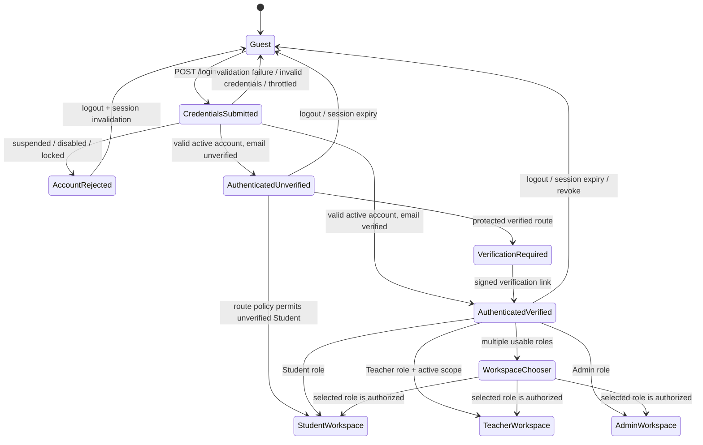

# AUTH-001 — Authentication audit và security contract

Ngày audit: 2026-11-25  
Nguồn kiểm tra: `routes/web.php`, `AuthController`, `User`, auth/session config, middleware, auth views, feature tests và `php artisan route:list --except-vendor`.

## 1. Phạm vi hiện tại

### Stack và storage

| Concern | Hiện trạng |
|---|---|
| Framework | Laravel 12.73 |
| Guard | `web` session guard, Eloquent provider |
| Session | Database session, lifetime lấy từ `SESSION_LIFETIME`, mặc định 120 phút |
| Password | `User` cast `hashed`; `remember_token` có trong model |
| Account state | `UserStatus` (`active`, `suspended`, `disabled`) + `locked_at` |
| Identity metadata | `email_verified_at`, `last_login_at`, `last_login_ip` đã có cột/model fillable |
| Reset storage | `password_reset_tokens` đã có; chưa có flow/controller/mail |
| CSRF | Web middleware + `@csrf` trên login form |
| Login throttle | Route `throttle:6,1`; chưa có limiter đặt tên theo email + IP |
| Mail | Mặc định `log`; chưa có password reset/invite/verification flow |

### Route classification hiện tại

| Route group | Current middleware | Đánh giá |
|---|---|---|
| `GET /login` | none | Đúng, cần `guest` ở AUTH-002 |
| `POST /login` | `throttle:6,1` | Có throttle nhưng cần named limiter |
| `POST /logout` | `auth` | Có session invalidation + CSRF rotation |
| `/forgot-password`, `/verify-email`, `/workspace` | none | View prototype; cần guest/auth/verified policy rõ ràng |
| `/student`, `/student/lessons/*`, `/student/practice/*` | none | Đang công khai; cần tách demo route và production route |
| `/student/learn`, scene, exam, chat | `auth`, một số route lặp `auth` | Đã bảo vệ authentication; cần kiểm tra active/role/scope ở từng action |
| `/teacher/*` | `workspace.role:teacher` trong `auth + active.account` group | Có role boundary; workspace redirect vẫn tĩnh |
| `/admin/*` | `workspace.role:admin` trong `auth + active.account` group | Có role boundary; cần production workspace và verified policy |
| `/ui/*` | none | Giữ làm prototype/demo, không được dùng làm production auth target |

## 2. Authentication state machine

### State invariants

1. Client-provided role, workspace or redirect never grants authorization.
2. `active` status alone is insufficient when `locked_at` is non-null.
3. Authentication establishes identity; Policy, scope and middleware establish access.
4. Invalid credentials and unknown email use the same user-visible response.
5. Any account rejection invalidates the current session.
6. Reset, invite, verification and session tokens are single-purpose, short-lived and never logged raw.

## 3. Redirect matrix contract

| Actor/state | Default destination | Allowed alternatives | Expected denial |
|---|---|---|---|
| Guest opens `/login` | Login form | Forgot/reset/verification entry points | — |
| Guest opens protected route | `/login` with safe internal intended URL | None for external URL | No data disclosure |
| Active Student, one role | Student learning dashboard | Internal lesson/exam/chat route if already authorized | `403`/redirect per route policy |
| Active Teacher, one role | Teacher workspace | Scoped course/exam/editor route | `403` outside scope |
| Active Admin, one role | Admin operations dashboard | Users/content/audit/AI usage | `403` for non-admin |
| Active user, multiple roles | Server-owned workspace chooser | Only roles held by user | Never trust `?role=` alone |
| Suspended/disabled/locked | Login with generic account-state error | Support contact | No workspace access |
| Authenticated unverified user | Verification notice where policy requires | Logout/login | No access to verified-only routes |
| Authenticated user with no usable role | Support/no-access state | Logout | No workspace access |

`/workspace?role=...` is a presentation hint only until AUTH-003 replaces it with a server-authorized workspace action.

## 4. Threat model

| Threat | Current exposure | Required control | Owner task |
|---|---|---|---|
| Credential stuffing | Generic login with route throttle only | Named limiter keyed by normalized email + IP, safe retry response, monitoring | AUTH-002 |
| User enumeration | Login error is generic; reset UI is not implemented | Generic forgot/reset response and identical timing where practical | AUTH-004 |
| Session fixation | Login regenerates session; logout invalidates | Regression test session ID rotation and remember-token behavior | AUTH-002 |
| CSRF | Login form has `@csrf`; web middleware active | Keep CSRF on every state-changing auth route; test missing token | AUTH-002/004/005 |
| Open redirect | No intended redirect implementation yet | Accept only same-host internal named/path targets | AUTH-002 |
| Privilege escalation | Role middleware + Policies exist; chooser is static | Server-owned role props, Policy matrix and cross-role E2E | AUTH-003/008 |
| Account-state bypass | `isActive()` checks status and lock | Apply `active.account` consistently to all production routes | AUTH-002 |
| Reset token theft/reuse | Reset flow absent | Hashed/single-use expiry, revoke sessions after reset, no raw token logs | AUTH-004 |
| Invite token theft/reuse | Invite flow absent | Hashed single-use expiry, revoke/resend invalidation, audit redaction | AUTH-005 |
| Email verification bypass | Verification view is static | Signed URL, expiry, resend throttle and verified route matrix | AUTH-006 |
| Session theft | Database sessions exist; no device/session UI | Secure cookie policy, session inventory and revoke controls | AUTH-007 |
| Sensitive audit/log leakage | No auth lifecycle audit contract | Redact password, reset/invite token, cookie and session ID | AUTH-002/007 |

## 5. Password, token và session policy contract

### Password

- Minimum policy: at least 12 characters for user-set passwords; confirmation required.
- Do not expose password policy details that enable account discovery; show actionable validation after the account context is known.
- Never log or audit raw passwords.
- Password reset and initial invite setup must use a single password form implementation.

### Reset/invite/verification tokens

- Reset token: Laravel password broker, 60-minute expiry, throttle at least 60 seconds, single-use.
- Invite token: proposed 24-hour expiry, hashed at rest, single-use; resend revokes the previous token.
- Verification link: signed and time-limited; resend is throttled.
- Raw token appears only in the outgoing URL/mail delivery boundary, never in logs, audit payloads or database plaintext.

### Session

- Regenerate session ID after successful login.
- Invalidate session and regenerate CSRF token on logout.
- Revoke all sessions after password reset or password change, except the newly authenticated session where the product flow explicitly requires it.
- Production cookie target: `Secure`, `HttpOnly`, appropriate `SameSite`, explicit domain/path and non-persistent remember behavior by default.

## 6. Response contract

### HTML/browser

- Invalid credentials: redirect back to login, preserve only email, show one generic credential error.
- Throttled login: redirect back with a retry message; do not reveal whether the email exists.
- Inactive account: logout, invalidate session and show a generic account unavailable message.
- Guest accessing protected page: redirect to login with a validated internal intended path.
- Authenticated user without role/scope: `403` or dedicated no-access page; never show another workspace.

### JSON/Inertia

- Authentication/authorization errors must use the existing Laravel web/Inertia conventions; do not invent a second error envelope in AUTH-001.
- Inactive account middleware may return `403` JSON with a generic message for `expectsJson()` requests.
- No response includes password hash, reset/invite token, raw session ID, locked account internals or role data not authorized for the current user.

## 7. Test matrix contract

| Area | Minimum cases | Layer |
|---|---|---|
| Login validation | Missing email/password, invalid email format, wrong password | Feature |
| Credential security | Unknown email vs wrong password same response; throttle by email + IP | Feature/security |
| Account state | Active, suspended, disabled, locked | Feature |
| Session | Regeneration after login, logout invalidation, remember behavior | Feature |
| Route protection | Guest for every production Student/Teacher/Admin route | Feature + E2E |
| Role/scope | Student→Teacher/Admin, Teacher→Admin, revoked teacher scope | Feature/policy |
| Redirect | Safe internal intended URL, external URL rejection, multi-role chooser | Feature + E2E |
| Reset | Neutral forgot response, valid/expired/reused token, password confirmation | Feature + Mail fake |
| Invite | Admin authorization, expiry/reuse/resend, role immutability | Feature + Mail fake |
| Verification | Signed/expired link, resend throttle, verified route policy | Feature + E2E |
| Session security | Revoke own/other session, password confirmation timeout | Feature |
| Audit/redaction | Login lifecycle events without password/token/session ID | Feature |
| UI states | Loading, validation, throttle, disabled account, keyboard focus | Vitest + Playwright |

## 8. Decisions locked by AUTH-001

- One `web` session guard remains the authentication boundary.
- Authorization remains server-owned through middleware, Policy and resource scope.
- Self-registration, social login, SSO and 2FA stay outside this phase.
- Production workspace routes will not depend on the static prototype chooser.
- All future auth work must add feature coverage before UI/E2E coverage is considered complete.

## 9. Handoff to AUTH-002

1. Build a login Form Request and named limiter.
2. Add `guest` and `auth + active.account` route matrix; remove production access from public prototype routes.
3. Implement safe internal intended redirect.
4. Update login telemetry fields (`last_login_at`, `last_login_ip`) without logging credentials.
5. Expand `AuthenticationTest` and `AccessPolicyTest` using the matrix above before changing workspace UI.
